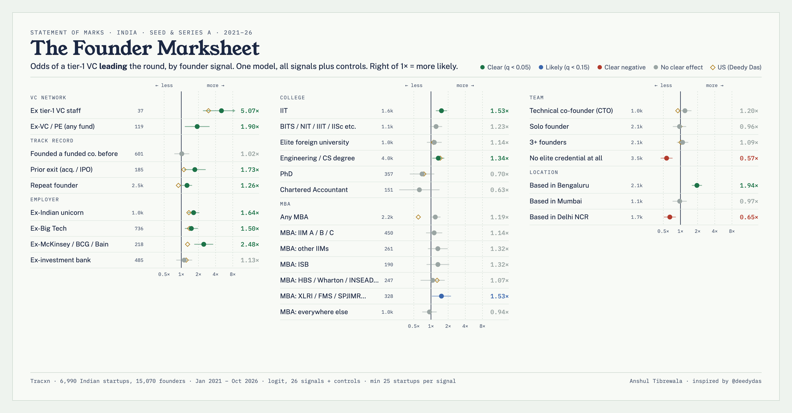

# The Founder Marksheet

**Which founder backgrounds go with getting your Seed or Series A *led* by a tier-1 Indian VC?**

An India version of [Deedy Das's US study](https://x.com/deedydas/status/2116577618816577767), built on 6,990 Indian startups and 15,070 founders with a Seed or Series A round between January 2021 and October 2026 (Tracxn data). It goes further than the original by splitting the MBA into its parts and breaking out 2025–26.

- **Read it:** [founder-marksheet.vercel.app](https://founder-marksheet.vercel.app)
- **Play with it:** [founder-marksheet.vercel.app/explore.html](https://founder-marksheet.vercel.app/explore.html). Pick a city, sector or period.
- **Query it:** the CSVs in [`data/`](data/) (see [Querying](#querying)).



## Headline results (2021–26, all else equal)

| Founder signal | Odds of a tier-1 lead |
|---|---|
| Ex tier-1 VC staff (37 startups) | 5.1× |
| Ex-McKinsey / BCG / Bain | 2.5× |
| Prior exit | 1.7× |
| Ex-Indian unicorn | 1.6× |
| IIT | 1.5× |
| Ex-Big Tech | 1.5× |
| Any MBA | 1.2× (no clear effect; US: 0.60×) |
| IIM A/B/C MBA | 2.0× raw, 1.1× after controls |
| Based in Bengaluru | 1.9× |
| Based in Delhi NCR | 0.65× |
| Based in Hyderabad | 0.55× |
| No elite credential on the team | 0.57× |

In 2025–26, ex-unicorn operators rose to 1.95× and the consulting edge fell to 1.35×. That's early data, because fewer recent rounds have a lead investor recorded yet.

**Correlation, not causation.** Credentials travel with networks, cities and sectors. The model controls for some of this, not all.

## What's in this repo

```
data/                   aggregate tables (no company or founder records)
  signals_<period>.csv  odds ratio per founder signal, for 2021-2026, 2021-2024, 2025-2026
  groups.csv            every city and sector with 100+ startups: size, tier-1 rate, adjusted odds vs the rest
  group_signals.csv     inside each city / sector: tier-1 rate with vs without each founder signal (raw)
  years.csv             startups, tier-1 rate and lead-investor coverage by year
  mba_decomposition.csv how each MBA type's raw edge shrinks as controls are added
  ladder.csv            tier-1 rate by credential profile
  meta.json             sample sizes and thresholds
analysis/
  load_tracxn.py        Tracxn Excel export(s) -> inputs
  analyze.py            codes founder signals and fits the models
  aggregates.py         turns model output into the public tables above
  tier1.example.json    template for your tier-1 fund list
site/                   the report and the explorer (static HTML)
queries/                example SQL and Python
```

The full data dictionary is in [`data/README.md`](data/README.md).

## Querying

The tables are plain CSV, so anything works. With [DuckDB](https://duckdb.org):

```sql
-- What does Hyderabad look like?
SELECT * FROM 'data/groups.csv' WHERE name = 'Hyderabad';

-- Inside Hyderabad, which founder backgrounds go with a tier-1 lead?
SELECT label, n_with, rate_with, rate_without, lift
FROM 'data/group_signals.csv'
WHERE kind = 'city' AND name = 'Hyderabad'
ORDER BY lift DESC;
```

More examples are in [`queries/examples.sql`](queries/examples.sql) and [`queries/examples.py`](queries/examples.py).

## Rerunning it on your own data

The company-level data isn't here. It comes from a Tracxn export licensed for internal use, so it can't be redistributed. If you have Tracxn access, you can rebuild everything:

1. In Tracxn, go to Transactions > Funding Rounds. Filter to Country = India, Round = Seed + Series A, and your date range, then export with all output sections.
2. Set up the environment:
   ```bash
   pip install -r requirements.txt
   ```
3. Convert the export(s):
   ```bash
   python analysis/load_tracxn.py tracxn/ export1.xlsx export2.xlsx
   ```
4. Copy `analysis/tier1.example.json` to `analysis/tier1.json` and list the funds you count as tier-1. The study used the 15 Indian funds that most often lead Seed and Series A rounds. The list isn't published, so the study stays about founders, not funds.
5. Fit the models:
   ```bash
   python analysis/analyze.py tracxn/ out/
   python analysis/analyze.py tracxn/ out/ 2021-2024
   python analysis/analyze.py tracxn/ out/ 2025-2026
   ```
6. Build the public tables:
   ```bash
   python analysis/aggregates.py out/dataset_tracxn.csv out/ data/
   ```

`out/extra.json` (MBA decomposition and ladder) comes from the report build. See the method below.

## Method

- **Unit:** a startup. A signal means "at least one founder has X", coded from Tracxn founder profiles (education and employers) and its Team Background and Founder Highlights tags.
- **Outcome:** at least one Seed or Series A round in the window had a tier-1 fund marked as lead investor. That was true for 570 of the 6,990 startups (8.2%).
- **Model:** one logistic regression with every signal, plus year, sector, city and founding-year controls. Nested signals (any MBA, any VC/PE, repeat founder, no elite credential) are swapped in one at a time. q-values are Benjamini–Hochberg. As in Deedy's study, signals held by fewer than 25 startups are dropped.
- **Privacy:** no published cell covers fewer than 25 startups. No company, founder or investor is named in the tables.
- **Limits:**
  - Founders whose education Tracxn doesn't record count as "no", which biases effects toward 1×.
  - Signals are parsed from text by rules, so expect a few miscodes.
  - The export has no founder gender field.
  - About 25% of 2025–26 startups have no lead investor recorded yet.

## Licence

- **Code:** MIT (see [`LICENSE`](LICENSE)).
- **Aggregate tables and charts:** © 2026 Anshul Tibrewala, [CC BY 4.0](https://creativecommons.org/licenses/by/4.0/). Please credit "The Founder Marksheet (Anshul Tibrewala), data: Tracxn".
- **Raw data:** belongs to Tracxn and is not included.

Made by Anshul Tibrewala with Claude. If you find something interesting, open an issue.
